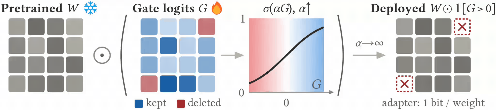

<h1 align="center">The Surprising Effectiveness of Deleting Weights in LLM Post-Training</h1>

<h3 align="center">NeurIPS 2026</h3>

<p align="center">
  <a href="https://jacklu-me.com/">Jack Lu</a><sup>1*</sup>,
  <a href="https://www.linkedin.com/in/zhenbang-yang-625b6a2a4/">Zhenbang Yang</a><sup>1*</sup>,
  <a href="https://scholar.google.com/citations?user=4odTWZMAAAAJ">Mike Lasby</a><sup>2</sup>,
  <a href="https://tejaspote.github.io/">Tejas Pote</a><sup>2</sup>,
  <a href="https://yani.ai/">Yani Ioannou</a><sup>2</sup>,
  <a href="https://mengyeren.com/">Mengye Ren</a><sup>1</sup><br>
  <sup>1</sup>New York University, <sup>2</sup>University of Calgary, <sup>*</sup>Equal contribution
</p>

<p align="center">
  <a href="https://arxiv.org/abs/2611.10866"></a>
  <a href="https://agenticlearning.ai/deleting-weights/"></a>
  <a href="https://cdn.agenticlearning.ai/dfb9bf24cee86b6d/neurips2026-poster-deleting-weights.pdf"></a>
  <a href="https://huggingface.co/Jacklu0831/deletion-tuning-masks"></a>
  <a href="LICENSE"></a>
</p>

Official code for Deletion Tuning, a post-training method that learns which pretrained weights of an LLM to delete.



---

## Overview

How little of a pretrained large language model (LLM) has to change for it to acquire new capabilities? We find that zeroing fewer than 0.05% of its weights, with no other modification, matches full fine-tuning (FFT) at scale across three LLM post-training regimes: reinforcement learning with verifiable rewards, supervised fine-tuning, and on-policy distillation. Our method, Deletion Tuning, learns a binary mask over the gate projection of transformer blocks. Two practical advantages follow: the trained mask is hundreds to thousands of times smaller than the corresponding FFT checkpoint, and Deletion Tuning forgets far less, which addresses a central challenge in continual learning. Under reinforcement learning, its prior-task accuracy stays near the base level while FFT, LoRA, and random sparse fine-tuning lose up to 5.4 points. To understand why masking alone suffices, we analyze the geometry of the learned weight changes under reinforcement learning using stable rank, spectrum drift, and principal-weight overlap. Compared with LoRA and random sparse fine-tuning, Deletion Tuning is closest to FFT across the three measures.

This repository trains Deletion Tuning with GRPO, SFT, and on-policy self-distillation (SDFT), saves each mask as a compressed bitmap, applies masks to base models, and evaluates them on the paper's benchmarks.

## Setup

The three training regimes use separate environments, each created with [uv](https://docs.astral.sh/uv/); activate the matching one before each section's commands.

**GRPO**:

```bash
uv venv envs/grpo --python 3.10 && source envs/grpo/bin/activate
uv pip install torch==2.8.0 torchvision==0.23.0 torchaudio==2.8.0 --index-url https://download.pytorch.org/whl/cu126
uv pip install https://github.com/Dao-AILab/flash-attention/releases/download/v2.8.3/flash_attn-2.8.3+cu12torch2.8cxx11abiTRUE-cp310-cp310-linux_x86_64.whl
uv pip install vllm==0.11.0
uv pip install -r requirements_grpo.txt
uv pip install -e "./verl[gpu,vllm,math]"
```

**SFT**:

```bash
uv venv envs/sft --python 3.10 && source envs/sft/bin/activate
uv pip install torch==2.7.1 --index-url https://download.pytorch.org/whl/cu126
uv pip install -r requirements_sft.txt
```

**SDFT**:

```bash
uv venv envs/sdft --python 3.12 && source envs/sdft/bin/activate
uv pip install -r requirements_sdft.txt
bash sdft/setup.sh
```

## GRPO

Build the GSM8K and SimpleRL-Zoo parquets under `data/`:

```bash
bash scripts/prepare_grpo_data.sh
```

Train one model with the paper's settings (`scripts/train_grpo.sh <model> <output_dir>`):

```bash
bash scripts/train_grpo.sh llama1b outputs/grpo/llama1b
```

| Model | Dataset |
| --- | --- |
| `llama1b` (Llama-3.2-1B-Instruct) | GSM8K |
| `llama3b` (Llama-3.2-3B-Instruct) | GSM8K |
| `llama8b` (Meta-Llama-3-8B-Instruct) | GSM8K |
| `qwen0.5b` (Qwen2.5-0.5B) | SimpleRL-Zoo |
| `qwen3b` (Qwen2.5-3B) | SimpleRL-Zoo |
| `qwen7b` (Qwen2.5-7B) | SimpleRL-Zoo |
| `qwen14b` (Qwen2.5-14B) | SimpleRL-Zoo |
| `qwen30b_a3b` (Qwen3-30B-A3B-Base, MoE) | SimpleRL-Zoo |

The shared settings are in `verl/verl/trainer/config/gsm8k.yaml` and `simplerl_zoo.yaml`, and the per-model ones in `scripts/train_grpo.sh`. To change one, add it after the output directory, for example `actor_rollout_ref.actor.optim.lr=1e-4`.

Masks are saved under `<output_dir>/global_step_<N>/mask/`, and metrics are logged to `<output_dir>/metrics.jsonl` and Weights & Biases (run `wandb login` first, or `export WANDB_MODE=offline`). For convenience, this utility prints a run's best validation result (GSM8K accuracy for Llama, the mean over the six SimpleRL-Zoo benchmarks for Qwen):

```bash
python src/summarize_grpo.py outputs/grpo/llama1b
```

Evaluate a mask on the same benchmarks with vLLM (`base` instead of a mask directory evaluates the base model):

```bash
bash scripts/evaluate_grpo.sh llama1b outputs/grpo/llama1b/global_step_125/mask outputs/eval/llama1b
```

## SFT

Deletion Tuning with supervised fine-tuning learns one mask per task on MMLU-Pro (14 categories, loaded from `TIGER-Lab/MMLU-Pro`) and BBEH (23 tasks). Get BBEH first:

```bash
git clone https://github.com/google-deepmind/bbeh data/bbeh
git -C data/bbeh checkout 80d12ca916b7158f22293fcf3144f4d3d854d4be
```

Then train one mask per task (`scripts/train_sft.sh <mmlu_pro|bbeh> <llama1b|llama3b> <output_dir>`); the masks are saved to `<output_dir>/masks/<task>/`:

```bash
bash scripts/train_sft.sh mmlu_pro llama1b outputs/sft/mmlu_pro_llama1b
```

Evaluate them on each task's test split:

```bash
bash scripts/evaluate_sft.sh mmlu_pro llama1b outputs/sft/mmlu_pro_llama1b/masks outputs/eval/mmlu_pro_llama1b
```

## SDFT

Deletion Tuning also trains with on-policy self-distillation ([SDFT](https://arxiv.org/abs/2601.19897)) of Qwen2.5-7B-Instruct on ToolAlpaca (`tooluse`) and Science (`science`). Masks are saved under `<output_dir>/mask_step_<N>/` and, at the end, `<output_dir>/mask/`:

```bash
bash scripts/train_sdft.sh tooluse outputs/sdft/tooluse
bash scripts/train_sdft.sh science outputs/sdft/science
```

Each evaluation command prints the test accuracy of a saved mask, and `base` evaluates Qwen2.5-7B-Instruct itself:

```bash
bash scripts/evaluate_sdft.sh tooluse outputs/sdft/tooluse/mask_step_200 outputs/eval/sdft_tooluse
bash scripts/evaluate_sdft.sh science outputs/sdft/science/mask outputs/eval/sdft_science
bash scripts/evaluate_sdft.sh tooluse base outputs/eval/sdft_tooluse_base
```

## Full Fine-Tuning Baseline

With `METHOD=fft`, each training command trains the full fine-tuning baseline instead, and the matching evaluation command takes its saved models in place of masks:

```bash
METHOD=fft bash scripts/train_grpo.sh llama1b outputs/grpo/llama1b_fft
bash scripts/evaluate_grpo.sh llama1b outputs/grpo/llama1b_fft/global_step_125/actor/huggingface outputs/eval/llama1b_fft
```

## Forgetting

This measures how much a Llama GSM8K Deletion Tuning run forgets over training: forward KL from the base model, and mean accuracy on six prior-task benchmarks (HellaSwag, TruthfulQA, MMLU, IFEval, WinoGrande, HumanEval) for the base model and the run's masks, in the GRPO environment:

```bash
bash scripts/retention.sh llama1b outputs/grpo/llama1b outputs/retention/llama1b
```

## Released Masks

We release our trained masks for the paper's main results on [Hugging Face](https://huggingface.co/Jacklu0831/deletion-tuning-masks), one folder per experiment (for example `grpo/qwen2.5-7b-simplerl-zoo`, `sft/llama-3.2-1b-instruct-mmlu-pro` with one mask per category, and `sdft/qwen2.5-7b-instruct-toolalpaca`). Download one and evaluate it like a mask you trained:

```bash
hf download Jacklu0831/deletion-tuning-masks --include "grpo/qwen2.5-7b-simplerl-zoo/*" --local-dir masks
bash scripts/evaluate_grpo.sh qwen7b masks/grpo/qwen2.5-7b-simplerl-zoo outputs/eval/qwen7b
```

Applying a mask to its base model sets the deleted weights to zero and saves a standard model that loads in Transformers or vLLM:

```bash
python src/apply_mask.py --base_model Qwen/Qwen2.5-7B --mask_dir masks/grpo/qwen2.5-7b-simplerl-zoo \
    --output_dir outputs/masked/qwen7b
```

## Repository Layout

| Path | Contents |
| --- | --- |
| `scripts/` | Commands with the paper's settings: prepare, train, evaluate, retention |
| `src/verl_adapters.py` | Deletion Tuning inside verl: mask setup, regularizer, rollout weights, mask saving |
| `src/learnable_sparsity/` | Masked linear layer and its learnable mask |
| `src/wanda_calibration.py` | Wanda scores and the mask initialization |
| `src/apply_mask.py` | Load a saved mask and apply it to a base model |
| `src/train_sft.py`, `src/sft_data.py`, `src/bbeh_*.py` | SFT training, data, and BBEH scoring |
| `src/evaluate_*.py`, `src/eval_grpo_common.py` | Evaluation of GRPO and SFT masks and models |
| `src/retention_*.py` | Prior-task accuracy and forward KL |
| `src/prepare_*.py`, `src/summarize_grpo.py` | GRPO data preparation and run summary |
| `sdft/` | SDFT training and evaluation, on top of [Self-Distillation](https://github.com/idanshen/Self-Distillation) |
| `verl/` | [verl](https://github.com/verl-project/verl) at commit `d4880cf`, with Deletion Tuning added |

## Roadmap

- [x] GRPO training and evaluation (verl; Llama 3.x on GSM8K, Qwen2.5 on SimpleRL-Zoo)
- [x] MoE (Qwen3-30B-A3B)
- [x] FFT baselines
- [x] SFT training and evaluation (MMLU-Pro, BBEH)
- [x] SDFT training and evaluation (ToolAlpaca, Science)
- [x] Trained masks uploaded to Hugging Face
- [x] Forgetting analysis
- [ ] LoRA and MTH baselines
- [ ] Geometric analysis

## Citation

If you have any questions or find any bugs, please feel free to contact Jack Lu (yl11330@nyu.edu). If you found our work helpful, please consider giving us a ⭐ and citing us!

```bibtex
@inproceedings{lu2026deleting,
  title     = {The Surprising Effectiveness of Deleting Weights in {LLM} Post-Training},
  author    = {Lu, Jack and Yang, Zhenbang and Lasby, Mike and Pote, Tejas and Ioannou, Yani and Ren, Mengye},
  booktitle = {Advances in Neural Information Processing Systems (NeurIPS)},
  year      = {2026}
}
```
